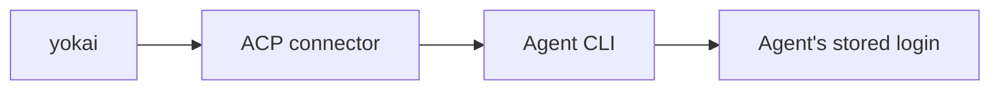

Use `yokai setup` to configure your project, including before Junji prepares its method files.
Run `yokai` to prepare missing inputs and execute phases. The cockpit's **Setup** control reopens preparation.

## `yokai`

Junji phase driver with owned onboarding. Settings: flags → effort overrides → durable preferences → defaults.

```bash
yokai [OPTIONS]
yokai setup [OPTIONS]
yokai guidance sensors|assess|sandbox
yokai doctor [--probe]
yokai migrate [--prefer legacy|new]
```

Interactive preparation lives in [one wizard](/yokai/docs/preparation). The former `configure`,
`sensors` and `assess` subcommands are removed. `/yokai sensors|assess|sandbox` remain helper skill
operations. `guidance` prints the bundled helper policy without setup. Headless execution requires
a reviewed gate and complete phase assessments; it never opens the wizard or writes defaults.

`setup` requires an interactive terminal on the host and a Git repository. It offers **Start run**
or **Save and exit** when ready. Before a method plan exists, it saves runtime preferences and shows
the Junji handoff. Every preparation visit ends with a final review and **Start run**. Bare `yokai`
still executes directly when the project is already prepared. New and edited phase assessments
require **Approve and continue**.

| Flag | Config file | Default / notes |
|------|-------------|-----------------|
| `--working-folder <path>` | — | `.koi/run` |
| `--repo <path>` | — | `.` |
| `--agent <name>` | `yokai.yml` `tiers:` | pin this launch (skip the candidate walk) |
| `--model <id>` | `yokai.yml` `tiers:` | pin this launch (skip the candidate walk) |
| `--effort <level>` | `yokai.yml` `tiers:` | pin this launch (skip the candidate walk) |
| `--permission <mode>` | `yokai.yml` | `approve-all` |
| `--max-iters <n>` | `yokai.yml` `build.max_iters` | omitted = unlimited |
| `--token-savings` | `yokai.yml` `token_savings` | reuse planning/implementation, review, and seal sessions per phase; require review; prohibit swarms |
| `--allow-gated` | — | Explicitly authorize gated phases for this invocation; standing directives still apply |
| `--no-token-savings` | `yokai.yml` | Explicitly disable saved token savings |
| `--guarded` | — | Halt at each `[gated]` phase (bare `yokai` also halts) |
| `--once` | — | Run one phase, then exit |
| `--headless` | — | Plain-text stream (also when stdin or stdout is not a TTY) |
| `--detail` | — | Compatibility flag; preparation always ends with final review and Start run |
| `--max-cost <usd>` | — | Run-wide ceiling; unbounded when omitted |
| `--max-tokens <n>` | — | Fallback ceiling when cost unavailable |
| `--theme <hour>` | env `YOKAI_THEME` | `terminal` (default) \| `yoru` \| `hiru` (`yoi` / `asa` alias to `yoru`) |
| `--host` | — | Force local supervisor despite `sandbox.enabled` |

Exit codes: `0` success; `2` halt (headless); preflight failure via `anyhow` (non-zero).

When `sandbox.enabled` and not `--host`, host `yokai` execs an inner supervisor in the VM (sets
`YOKAI_SANDBOX_INNER=1` on the inner process).

### TUI keys (non-headless)

| Key | Action |
|-----|--------|
| `w` | Cycle cockpit → sessions → deliverable |
| `t` | Cycle theme |
| `p` / Setup | Open preparation while the run is stopped |
| `x` | Abort in-flight phase |
| `q` / `Esc` | Open quit confirmation; `y` confirms and kills the in-flight agent, `n` cancels. In Deliverable patch focus, `Esc` returns to the tree |
## Environment variables

| Variable | Used by | Purpose |
|----------|---------|---------|
| `YOKAI_THEME` | `yokai --theme` | Cockpit theme: `terminal` (default), `yoru`, `hiru` (`yoi` / `asa` alias to `yoru`) |
| `YOKAI_SANDBOX_INNER` | yokai sandbox | Set to `1` or `true` on in-VM supervisor — prevents re-launch and onboarding |
| `KOI_DATA_DIR` | yokai sandbox launcher | Override `~/.local/share/koi` (Linux harness ELFs) |
| `ANTHROPIC_API_KEY` | claude auth hint | Optional; `doctor` warns when unset (connector may still use `claude auth login`) |
| `CODEX_API_KEY` | codex auth hint | Optional; takes precedence over `OPENAI_API_KEY` for the Codex adapter |
| `OPENAI_API_KEY` | codex auth hint | Fallback API key when `CODEX_API_KEY` is unset |
| `NO_BROWSER` | Codex ACP adapter | Set to `1` to hide ChatGPT browser login in headless/sandbox environments |
| `HOME` | sandbox launcher | Resolves data dir when `KOI_DATA_DIR` unset |

Agent credentials otherwise live inside each agent (e.g. `claude auth login`, OpenCode `/connect`);
there is no separate driver login.
## Agent login

There is no driver login. yokai drives an **agent**; credentials live in the agent's store.



| Agent | Typical login |
|-------|----------------|
| **claude** (default) | `claude auth login`, or `claude setup-token`, or `export ANTHROPIC_API_KEY=…` |
| **cursor** | Cursor CLI credentials (`cursor-agent`) |
| **opencode** | `opencode`, then `/connect` for a provider |
| **codex** | Codex ChatGPT login, or `export CODEX_API_KEY=…` (else `OPENAI_API_KEY`). In sandbox, prefer an API key and `NO_BROWSER=1` |

Check Claude anytime: `claude auth status`. Log in **before** unattended runs. Unauthenticated runs fail fast instead of hanging.
## Develop without installing

From the repo root:

```bash
cargo run -p yokai -- doctor --probe
cargo run -p yokai --
```
## Agents supported today

Native ACP connector drives **`claude`**, **`cursor`**, **`opencode`**, and **`codex`**
([ADR-0003](https://github.com/getkoi/koi/blob/main/crates/yokai/docs/adr/0003-native-acp-connector-only.md)).
gemini and fine-grained policy files are not supported.

## Board and optional Jira publication

The mandatory local board is execution input; BACKLOG.md is generated read-only. Use explicit
migration for legacy efforts. Use `/junji connect BOARD_URL` for optional Jira publication: the
dedicated host agent uses its official Atlassian Jira MCP with host-managed OAuth. Approve one exact
readable summary, including publishing host and named server; the pinned host publisher applies
accepted work. Saved setup is not verified delivery. Require agent-reported actual remote readbacks,
not narrative success or an independent runtime transport audit; missing evidence stays pending/review.

`visibility prepare`, `review` and `sync` remain internal agent tooling, not an engineer setup
checklist. Optional `--agent`, `--mcp-server` and `--model` select the publishing host, named server
and model on preparation. Prefer the known requesting host; only new preparation without that context
uses `claude` / `atlassian` defaults. Saved host, server and optional model remain independent of coding
candidates and model tiers. Sync cannot override these settings; changes require prepare/review.
Legacy publishers missing `mcp_server` need explicit reconnect. ACP does not guarantee OAuth reuse
or host-config inheritance. An unavailable named server fails explicitly, without credential copying or automatic
provider switching. Use the host's MCP connection/OAuth UI for interactive sign-in. Headless auth
stays pending without opening a browser; local execution continues. Koi owns no Jira login, token
storage, refresh or proxy and has no API-token fallback. Existing OS credentials are not deleted.
Status is read-only; import and resolve preserve explicit selection/reconciliation.
During driven execution the supervisor owns verified state and sync; coding phase agents never call
Jira tools. Existing profiles, bindings and receipts remain compatible. [Board](/koi/docs/board) · [Jira visibility](/yokai/docs/visibility)

Shared board commands include propose, show-proposal, accept-proposal and discard-proposal through
`yokai board` or standalone `junji-board`. Propose saves candidate work; acceptance names the exact
proposal ID and reviewed board revision. Pending review pauses before the next phase.
